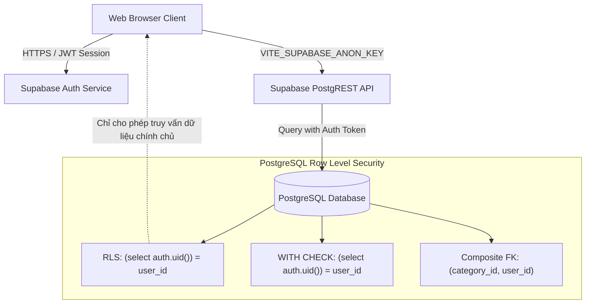

<p align="center">
  
</p>

<h1 align="center">MoneyMate — Smart Personal Finance Platform</h1>

<p align="center">
  <strong>Nền tảng quản lý tài chính cá nhân hiện đại, thông minh & bảo mật đa tầng</strong>
  <br />
  <em>Theo dõi thu chi • Phân tích cơ cấu dòng tiền • Thiết lập ngân sách thông minh</em>
</p>

<p align="center">
  <a href="https://money-mate-pi-coral.vercel.app" target="_blank">
    
  </a>
  <a href="https://react.dev/" target="_blank">
    
  </a>
  <a href="https://www.typescriptlang.org/" target="_blank">
    
  </a>
  <a href="https://vite.dev/" target="_blank">
    
  </a>
  <a href="https://supabase.com/" target="_blank">
    
  </a>
</p>

---

##  Tổng Quan (Overview)

**MoneyMate** là ứng dụng web quản lý tài chính cá nhân được thiết kế theo tiêu chuẩn Fintech hiện đại (UI/UX Pro Max), áp dụng kiến trúc Bento Grid, hỗ trợ chuyển đổi giao diện Sáng/Tối (Dark/Light Mode), và bảo mật cấp ngân hàng với **PostgreSQL Row Level Security (RLS)** trên nền tảng Supabase.

Hệ thống cho phép người dùng ghi chép thu chi tức thì, phân loại danh mục tùy biến, phân tích tỷ trọng chi tiêu bằng biểu đồ trực quan, và kiểm soát ngân sách cá nhân dễ dàng trên mọi thiết bị.

---

## ✨ Tính Năng Nổi Bật (Key Features)

### 1. 📊 Bảng Điều Khiển Tài Chính Bento Grid (Executive Dashboard)
- **4 Chỉ Số Tài Chính Hàng Đầu (Top KPI Cards)**:
  - **Tổng Số Dư Khả Dụng (Net Balance)**: Tính toán chênh lệch dòng tiền thời gian thực.
  - **Tổng Thu Nhập Tháng Này (Monthly Income)**: Theo dõi dòng tiền vào với xu hướng tăng trưởng.
  - **Tổng Chi Tiêu Tháng Này (Monthly Expense)**: Cảnh báo dòng tiền ra theo chu kỳ tháng.
  - **Tỷ Lệ Tiết Kiệm (Savings Rate)**: Đánh giá sức khỏe tài chính dựa trên ngưỡng chuẩn tích lũy $\ge 20\%$.
- **Hỗ trợ Dữ liệu Mẫu (Demo Fallback)**: Tự động minh họa dữ liệu biểu đồ trực quan sinh động khi tài khoản mới tạo chưa phát sinh giao dịch.

### 2. ⚡ Ghi Chép Giao Dịch Nhanh Chóng (Fast Expense Tracking)
- Nút chọn nhanh mệnh giá thông minh (50k, 100k, 200k, 500k, 1tr, 2tr) tiết kiệm thời gian nhập liệu.
- Phân loại trực quan: Khoản Chi (Đỏ) vs. Khoản Thu (Xanh Emerald).
- Định dạng tiền tệ VND tự động với bộ số học chính xác.
- Hỗ trợ chọn danh mục có màu sắc và biểu tượng đại diện nhận diện ngay tức thì.

### 3. 📈 Phân Tích & Báo Cáo Trực Quan (Interactive Analytics)
- **Biểu đồ Cơ Cấu Chi Tiêu (Expense Donut/Pie Chart)**: Trực quan hóa tỷ trọng chi tiêu theo từng danh mục (Ăn uống, Mua sắm, Di chuyển, v.v.) bằng Recharts với tooltip tương tác mượt mà.
- **Biểu đồ Biến Động Dòng Tiền Theo Tháng (Monthly Comparison Bar Chart)**: So sánh trực tiếp Tổng Thu vs. Tổng Chi qua các tháng gần nhất để kiểm soát kế hoạch chi tiêu.

### 4. 🗂️ Quản Lý Danh Mục Tùy Biến (Category Management)
- Tự do khởi tạo, chỉnh sửa và quản lý danh mục thu/chi.
- Bảng màu hiện đại (Modern Color Palette) kèm bộ sưu tập Emoji biểu trưng phong phú.
- Cơ chế kiểm tra toàn vẹn dữ liệu: Cảnh báo an toàn khi xóa danh mục đang có giao dịch liên kết.

### 5. 🔍 Bộ Lọc & Tìm Kiếm Nâng Cao (Advanced Filters)
- Tìm kiếm tức thì theo từ khóa ghi chú hoặc số tiền.
- Lọc đa chiều: Theo loại giao dịch (Tất cả / Khoản Thu / Khoản Chi), theo Danh mục, và theo Tháng phát sinh.
- Phân trang mượt mà (Pagination) tối ưu tải dữ liệu lớn.

### 6. 🎨 Trải Nghiệm Người Dùng Đỉnh Cao (UI/UX Pro Max)
- **Dark/Light Mode**: Chuyển đổi mượt mà, lưu trạng thái tự động vào `localStorage`.
- **Hệ Thống Icon SVG Thuần Túy**: Tối ưu dung lượng bundle, không phụ thuộc bộ icon cồng kềnh.
- **Micro-animations**: Hiệu ứng pulse dot cho tài khoản đã xác thực, đổ bóng và kính mờ (Glassmorphism).
- **Responsive 100%**: Trải nghiệm trơn tru từ Mobile (320px), Tablet đến màn hình Desktop Ultra-wide.

---

## 🛡️ Kiến Trúc Bảo Mật Đa Tầng (Security Architecture)

Hệ thống tuân thủ nguyên tắc **Zero Trust** đối với dữ liệu người dùng:



- **Row Level Security (RLS)**: Mọi bảng (`categories`, `transactions`) đều bật RLS với subquery tối ưu `(select auth.uid())`, ngăn chặn hoàn toàn rò rỉ dữ liệu giữa các người dùng.
- **Khóa Ngoại Hợp Phần (Composite Foreign Key)**: Giao dịch chỉ được phép liên kết với danh mục do chính người dùng đó sở hữu (`FOREIGN KEY (category_id, user_id) REFERENCES categories(id, user_id)`).
- **Zero Frontend Secrets**: Chỉ sử dụng `VITE_SUPABASE_ANON_KEY` công khai; tuyệt đối không bao giờ để lộ `service_role` key trên client.

---

## 💻 Công Nghệ Sử Dụng (Tech Stack)

| Lớp (Layer) | Công nghệ | Phiên bản | Mục đích sử dụng |
| :--- | :--- | :--- | :--- |
| **Core Framework** | React | 19.x | Thư viện UI hiện đại nhất, hỗ trợ React Server / Strict Mode |
| **Language** | TypeScript | 6.x | Kiểm soát kiểu dữ liệu tĩnh nghiêm ngặt (Strict Type Safety) |
| **Build Tool** | Vite | 8.x | Đóng gói siêu tốc (HMR, Rollup production bundle) |
| **Routing** | React Router DOM | 7.x | Điều hướng Client-Side Routing & Protected Routes |
| **Data Visualizations** | Recharts | 3.x | Biểu đồ SVG tương tác (Donut Chart, Comparison Bar Chart) |
| **Database & Auth** | Supabase | 2.x | PostgreSQL, GoTrue Auth, Realtime & Row Level Security |
| **Linter & Code Quality**| Oxlint | 1.x | Kiểm tra chất lượng mã nguồn hiệu năng cao bằng Rust |
| **Deployment** | Vercel | Cloud | Nền tảng điện toán biên với cơ chế SPA Rewrite Fallback |

---

## 📁 Cấu Trúc Thư Mục (Project Structure)

```text
MoneyMate/
├── .agent/                    # Quy chuẩn và bộ kỹ năng AI Agent
├── public/                    # Tài nguyên tĩnh (Favicon SVG, Icons)
├── src/
│   ├── components/            # Giao diện người dùng phân tầng
│   │   ├── auth/              # Xác thực: SignIn, SignUp, ProtectedRoute
│   │   ├── dashboard/         # Dashboard: Bento grid, TransactionList, Form, Charts, Modals
│   │   │   ├── AddTransactionForm.tsx
│   │   │   ├── CategoryManager.tsx
│   │   │   ├── ConfirmDeleteModal.tsx
│   │   │   ├── EditTransactionModal.tsx
│   │   │   ├── ExpensePieChart.tsx
│   │   │   ├── MonthlyBarChart.tsx
│   │   │   ├── TransactionList.tsx
│   │   │   └── UserDashboard.tsx
│   │   └── ui/                # UI tái sử dụng: Navbar, StatCard, Icons
│   ├── context/               # React Context: AuthContext, ThemeContext
│   ├── hooks/                 # Custom Hooks xử lý nghiệp vụ tài chính
│   ├── lib/                   # Khởi tạo Supabase client, Formatters, Date filters
│   ├── types/                 # Định nghĩa TypeScript Domain Model & Database Schema
│   ├── utils/                 # Thuật toán tính toán dòng tiền, phân tích số liệu
│   ├── App.css                # Hệ thống CSS Design Tokens, Theme & Animations
│   ├── App.tsx                # Layout và bảng định tuyến ứng dụng
│   └── main.tsx               # Entry point
├── supabase/                  # DDL Schema & Migrations phân quyền RLS
│   ├── migrations/
│   │   ├── 20261011_optimize_rls.sql
│   │   └── 20261012_composite_category_fk.sql
│   └── schema.sql
├── vercel.json                # Cấu hình rewrite URL cho React Router trên Vercel
├── vite.config.ts             # Cấu hình đóng gói Vite
└── package.json
```

---

## 🚀 Hướng Dẫn Cài Đặt & Khởi Chạy (Getting Started)

### 1. Yêu Cầu Môi Trường
- **Node.js**: Phiên bản `18.0.0` trở lên (Khuyến nghị LTS).
- **Trình quản lý gói**: `npm` hoặc `pnpm`.

### 2. Cài Đặt Mã Nguồn

```bash
# Clone dự án từ GitHub
git clone https://github.com/Khoa-NKD/Money-Mate.git

# Di chuyển vào thư mục dự án
cd Money-Mate

# Cài đặt các thư viện phụ thuộc
npm install
```

### 3. Cấu Hình Biến Môi Trường

Tạo tệp `.env` tại thư mục gốc của dự án (dựa trên mẫu [`.env.example`](file:///d:/MoneyMate/.env.example)):

```env
# Supabase Configuration for MoneyMate
VITE_SUPABASE_URL=https://your-project-ref.supabase.co
VITE_SUPABASE_ANON_KEY=your-supabase-anon-key
```

### 4. Thiết Lập Cơ Sở Dữ Liệu (Supabase SQL Setup)

Mở **SQL Editor** trong trang quản trị dự án Supabase và thực thi lần lượt các tệp theo thứ tự:
1. `supabase/schema.sql`: Khởi tạo bảng `categories`, `transactions` và thiết lập RLS cơ bản.
2. `supabase/migrations/20261011_optimize_rls.sql`: Tối ưu hóa hiệu năng Policy với `(select auth.uid())`.
3. `supabase/migrations/20261012_composite_category_fk.sql`: Ràng buộc toàn vẹn sở hữu danh mục đa tầng.

### 5. Khởi Chạy Môi Trường Phát Triển

```bash
# Chạy dev server cục bộ
npm run dev
```

Mở trình duyệt và truy cập: `http://localhost:5173`

### 6. Kiểm Tra Chất Lượng Mã & Đóng Gói (Build & Lint)

```bash
# Kiểm tra code quality với Oxlint
npm run lint

# Biên dịch kiểm tra TypeScript và đóng gói Production
npm run build
```

---

## ☁️ Triển Khai Lên Vercel (Deployment)

Dự án đã tích hợp sẵn tệp cấu hình [`vercel.json`](file:///d:/MoneyMate/vercel.json) để xử lý hoàn hảo cơ chế định tuyến Client-Side Routing (tránh lỗi 404 khi người dùng F5 hoặc gõ URL trực tiếp).

1. Truy cập [Vercel Dashboard](https://vercel.com/) và import repository `Khoa-NKD/Money-Mate`.
2. Điền 2 biến môi trường tại phần **Environment Variables**:
   - `VITE_SUPABASE_URL`
   - `VITE_SUPABASE_ANON_KEY`
3. Nhấn **Deploy**.

---

## 📜 Giấy Phép & Tác Quyền (License)

Dự án được phát hành theo giấy phép [MIT License](LICENSE).  
Bản quyền © 2026 **Khoa-NKD**. Toàn quyền bảo lưu.
